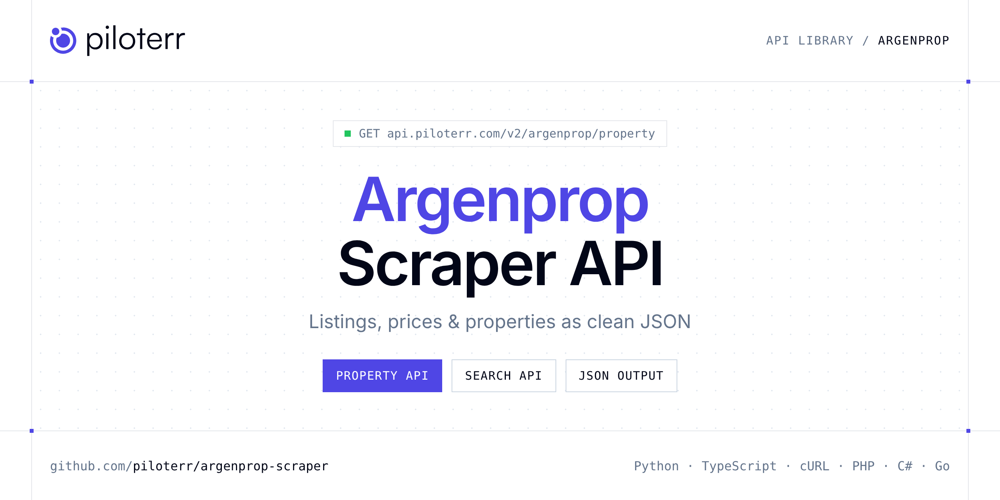

<p align="center">
  <a href="https://www.piloterr.com"></a>
</p>

# Argenprop Scraper API

[](https://discord.gg/CFj3ph8aHU) [](https://app.piloterr.com) [](https://app.piloterr.com/openapi) [](LICENSE)

The **Piloterr Argenprop Scraper API** lets you extract public data from Argenprop as **clean, structured JSON** — no proxies, headless browsers or HTML parsing to maintain. Endpoints available in production:

- **Argenprop Property API** — Read one Argenprop listing from its URL or id.
- **Argenprop Search API** — Search Argenprop by neighbourhood or city.

Use it for property price monitoring, market analytics, investment sourcing or rental yield models.

| Endpoint | Path | Credits | What you get |
|---|---|---|---|
| [Argenprop Property API](#argenprop-property-api) | `/v2/argenprop/property` | 1 | Read one Argenprop listing from its URL or id. You get price, address, rooms, expenses, and the agent when the page shows them. |
| [Argenprop Search API](#argenprop-search-api) | `/v2/argenprop/search` | 1 | Search Argenprop by neighbourhood or city. Set operation to venta or alquiler, and property_type such as departamentos or casas. Page with pagina. |

## Table of contents

- [How it works](#how-it-works)
- [Argenprop Property API](#argenprop-property-api)
- [Argenprop Search API](#argenprop-search-api)
- [Code examples in other languages](#code-examples-in-other-languages)
- [Practical use cases](#practical-use-cases)
- [Why Piloterr?](#why-piloterr)
- [FAQ](#faq)
- [Related scrapers](#related-scrapers)
- [Support](#support)

## How it works

1. **Create a free Piloterr account** and copy your API key from the [dashboard](https://app.piloterr.com).
2. **Send a `GET` (or `POST`) request** to `https://api.piloterr.com/v2/...` with the header `x-api-key: YOUR_API_KEY`.
3. **Receive structured JSON** — Piloterr handles rendering, proxies, retries and parsing.

```bash
export PILOTERR_API_KEY="your-api-key"
pip install requests        # Python
# TypeScript: Node.js 18+ (native fetch), run with `npx tsx file.ts`
```

> Every endpoint accepts both `GET` (query string) and `POST` (JSON body with the same fields).

## Argenprop Property API

Read one Argenprop listing from its URL or id. You get price, address, rooms, expenses, and the agent when the page shows them.

`GET | POST https://api.piloterr.com/v2/argenprop/property` · **1 credit per request** · [Full reference](https://app.piloterr.com/openapi)

### Request parameters

| Parameter | Type | Required | Description |
|---|---|---|---|
| `query` | string | ✅ | The full listing page on argenprop.com. Copy it from results[].url on [Argenprop Search](https://www.piloterr.com/library/argenprop-search). The listing id is the number after the double dash. |

### Python example

```python
import json
import os
import requests

response = requests.get(
    "https://api.piloterr.com/v2/argenprop/property",
    headers={"x-api-key": os.environ["PILOTERR_API_KEY"]},
    params={
        "query": "https://www.argenprop.com/departamento-en-venta-en-palermo-chico-5-ambientes--20724993",
    },
    timeout=60,
)
response.raise_for_status()
data = response.json()

print(json.dumps(data, indent=2, ensure_ascii=False)[:2000])
```

### TypeScript example

```typescript
type ArgenpropProperty = {
  id?: string;
  url?: string;
  city?: string;
  agent?: {
    url?: string;
    name?: string;
    image?: string;
  };
  price?: number;
  rooms?: number;
  title?: string;
  images?: string[];
  address?: string;
  garages?: number;
  toilets?: number;
  bedrooms?: number;
  currency?: string;
  expenses?: unknown;
  latitude?: number;
  location?: string;
  services?: string[];
  age_label?: string;
  age_years?: number;
  amenities?: string[];
  bathrooms?: number;
  condition?: string;
  longitude?: number;
  operation?: string;
  video_url?: string;
  [key: string]: unknown;
};

const params = new URLSearchParams({
  "query": "https://www.argenprop.com/departamento-en-venta-en-palermo-chico-5-ambientes--20724993",
});

const response = await fetch(`https://api.piloterr.com/v2/argenprop/property?${params}`, {
  headers: { "x-api-key": process.env.PILOTERR_API_KEY! },
});
if (!response.ok) throw new Error(`Piloterr error ${response.status}: ${await response.text()}`);

const data = (await response.json()) as ArgenpropProperty;

console.log(JSON.stringify(data, null, 2).slice(0, 2000));
```

<details>
<summary><b>POST variant</b></summary>

```http
POST https://api.piloterr.com/v2/argenprop/property
x-api-key: YOUR_API_KEY
Content-Type: application/json

{"query": "https://www.argenprop.com/departamento-en-venta-en-palermo-chico-5-ambientes--20724993"}
```
</details>

### Output example

Example response from the API reference, abridged — real values depend on the page you scrape.

```json
{
  "id": "20724993",
  "url": "https://www.argenprop.com/departamento-en-venta-en-palermo-chico-5-ambientes--20724993",
  "city": "Palermo",
  "agent": {
    "url": "example",
    "name": "example",
    "image": "example"
  },
  "price": 2400000,
  "rooms": 5,
  "title": "Torre bellini! piso alto! balcón c/espec vista panorámica! t/a nuevo! full amenities! 2 coch! único!",
  "images": [
    "https://www.argenprop.com/static-content/39942702/4792c440-1cec-4120-a78c-953e933e9303.jpg",
    "https://www.argenprop.com/static-content/39942702/2fd7f06d-795b-4a7e-89da-8e774c1dfd1a_u_medium.jpg"
  ],
  "address": "Jerónimo Salguero 2700",
  "garages": 2,
  "toilets": 1,
  "bedrooms": 3,
  "currency": "USD",
  "expenses": null,
  "latitude": -34.58001,
  "location": "Jerónimo Salguero 2700, Palermo, CABA, Capital Federal",
  "services": [
    "Agua corriente",
    "Calefacción"
  ],
  "age_label": "17 años",
  "age_years": 17,
  "amenities": [
    "Agua corriente",
    "Aire acondicionado individual"
  ],
  "bathrooms": 4,
  "condition": "Excelente",
  "longitude": -58.40805,
  "operation": "venta",
  "video_url": "https://www.youtube.com/embed/dKv144vnbbg?controls=0&rel=0"
}
```

### Response fields

| Field | Type | Description |
|---|---|---|
| `id` | string |  |
| `url` | string |  |
| `city` | string |  |
| `agent` | object |  |
| `agent.url` | string |  |
| `agent.name` | string |  |
| `agent.image` | string |  |
| `price` | integer |  |
| `rooms` | integer |  |
| `title` | string |  |
| `images` | string[] |  |
| `address` | string |  |
| `garages` | integer |  |
| `toilets` | integer |  |
| `bedrooms` | integer |  |
| `currency` | string |  |
| `expenses` | object |  |
| `latitude` | number |  |
| `location` | string |  |
| `services` | string[] |  |
| `age_label` | string |  |
| `age_years` | integer |  |
| `amenities` | string[] |  |
| `bathrooms` | integer |  |
| `condition` | string |  |

## Argenprop Search API

Search Argenprop by neighbourhood or city. Set operation to venta or alquiler, and property_type such as departamentos or casas. Page with pagina.

`GET | POST https://api.piloterr.com/v2/argenprop/search` · **1 credit per request** · [Full reference](https://app.piloterr.com/openapi)

### Request parameters

| Parameter | Type | Required | Description |
|---|---|---|---|
| `query` | string | ✅ | The place to search, or a full Argenprop results page. |
| `page` | number | — | Which page of the list to open. The first page is 1. The placeholder is 2. |
| `operation` | string | — | Sale or rent, when query is a place name. The placeholder is venta, which means for sale. alquiler is a long-term rental. alquiler-temporal is a short stay. sale, buy, and rent are accepted as aliases. |
| `property_type` | string | — | The kind of home, when query is a place name. The placeholder is departamentos, which means apartments. Also accepted: casas (houses), ph, terrenos, locales, oficinas, and quintas. casa and house map to casas. |

### Python example

```python
import json
import os
import requests

response = requests.get(
    "https://api.piloterr.com/v2/argenprop/search",
    headers={"x-api-key": os.environ["PILOTERR_API_KEY"]},
    params={
        "query": "palermo",
    },
    timeout=60,
)
response.raise_for_status()
data = response.json()

print(json.dumps(data, indent=2, ensure_ascii=False)[:2000])
```

### TypeScript example

```typescript
type ArgenpropSearch = {
  results?: {
    id?: string;
    url?: string;
    image?: string;
    price?: number;
    rooms?: number;
    title?: string;
    address?: string;
    toilets?: unknown;
    bedrooms?: number;
    currency?: string;
    expenses?: unknown;
    age_label?: string;
    age_years?: number;
    bathrooms?: number;
    condition?: unknown;
    operation?: string;
    agent_name?: string;
    disposition?: unknown;
    photo_count?: number;
    neighborhood?: string;
    price_display?: string;
    property_type?: string;
    covered_area_m2?: number;
    expenses_display?: unknown;
    expenses_currency?: unknown;
    [key: string]: unknown;
  }[];
  pagination?: {
    next?: string;
    page?: number;
    per_page?: number;
    total_pages?: number;
    total_results?: number;
  };
};

const params = new URLSearchParams({
  "query": "palermo",
});

const response = await fetch(`https://api.piloterr.com/v2/argenprop/search?${params}`, {
  headers: { "x-api-key": process.env.PILOTERR_API_KEY! },
});
if (!response.ok) throw new Error(`Piloterr error ${response.status}: ${await response.text()}`);

const data = (await response.json()) as ArgenpropSearch;

console.log(JSON.stringify(data, null, 2).slice(0, 2000));
```

<details>
<summary><b>POST variant</b></summary>

```http
POST https://api.piloterr.com/v2/argenprop/search
x-api-key: YOUR_API_KEY
Content-Type: application/json

{"query": "palermo"}
```
</details>

### Output example

Example response from the API reference, abridged — real values depend on the page you scrape.

```json
{
  "results": [
    {
      "id": "20724993",
      "url": "https://www.argenprop.com/departamento-en-venta-en-palermo-chico-5-ambientes--20724993",
      "image": "https://www.argenprop.com/static-content/39942702/4792c440-1cec-4120-a78c-953e933e9303_u_small.jpg",
      "price": 2400000,
      "rooms": 5,
      "title": "Torre bellini! piso alto! balcón c/espec vista panorámica! t/a nuevo! full amenities! 2 coch! único!",
      "address": "Jerónimo Salguero 2700, Palermo Chico",
      "toilets": null,
      "bedrooms": 3,
      "currency": "USD",
      "expenses": null,
      "age_label": "17 años",
      "age_years": 17,
      "bathrooms": 4,
      "condition": null,
      "operation": "venta",
      "agent_name": "LOPEZ CASTROMIL PROPIEDADES",
      "disposition": null,
      "photo_count": 46,
      "neighborhood": "Palermo Chico",
      "price_display": "USD 2.400.000",
      "property_type": "departamento",
      "covered_area_m2": 275,
      "expenses_display": null,
      "expenses_currency": null
    }
  ],
  "pagination": {
    "next": "https://www.argenprop.com/departamentos/venta/palermo?pagina-2",
    "page": 1,
    "per_page": 20,
    "total_pages": 577,
    "total_results": 11536
  }
}
```

### Response fields

| Field | Type | Description |
|---|---|---|
| `results[]` | object[] |  |
| `results[].id` | string |  |
| `results[].url` | string |  |
| `results[].image` | string |  |
| `results[].price` | integer |  |
| `results[].rooms` | integer |  |
| `results[].title` | string |  |
| `results[].address` | string |  |
| `results[].toilets` | object |  |
| `results[].bedrooms` | integer |  |
| `results[].currency` | string |  |
| `results[].expenses` | object |  |
| `results[].age_label` | string |  |
| `results[].age_years` | integer |  |
| `results[].bathrooms` | integer |  |
| `results[].condition` | object |  |
| `results[].operation` | string |  |
| `results[].agent_name` | string |  |
| `results[].disposition` | object |  |
| `results[].photo_count` | integer |  |
| `results[].neighborhood` | string |  |
| `results[].price_display` | string |  |
| `results[].property_type` | string |  |
| `results[].covered_area_m2` | integer |  |
| `results[].expenses_display` | object |  |

## Code examples in other languages

Ready-to-run examples live in the [`examples/`](examples) folder. Each one reads your key from the `PILOTERR_API_KEY` environment variable.

| Language | Property | Search |
|---|---|---|
| cURL (Bash) | [`property`](examples/curl/property.sh) | [`search`](examples/curl/search.sh) |
| PHP | [`property`](examples/php/property.php) | [`search`](examples/php/search.php) |
| C# | [`property`](examples/csharp/Property.cs) | [`search`](examples/csharp/Search.cs) |
| Go | [`property`](examples/go/property.go) | [`search`](examples/go/search.go) |
| Java | [`property`](examples/java/PropertyExample.java) | [`search`](examples/java/SearchExample.java) |
| Ruby | [`property`](examples/ruby/property.rb) | [`search`](examples/ruby/search.rb) |
| Node.js | [`property`](examples/nodejs/property.mjs) | [`search`](examples/nodejs/search.mjs) |

## Practical use cases

- **Price monitoring** — Track asking prices and price drops per area.
- **Market analytics** — Measure inventory, days on market and price per m² / sqft.
- **Investment sourcing** — Detect undervalued properties as soon as they are listed.
- **Rental yield models** — Combine sale and rent listings to estimate yields.
- **Proptech products** — Power portals, valuation tools and alerts with structured listings.

## Why Piloterr?

- **No infrastructure** — no proxies, headless browsers or CAPTCHA solving to run yourself.
- **Structured JSON** — stable, documented fields instead of brittle HTML selectors.
- **Pay per request** — transparent credit cost per endpoint, failed requests are retried for you.
- **One API key, hundreds of sources** — Argenprop plus many other e-commerce, search and company data endpoints in the [Piloterr library](https://www.piloterr.com/library).
- **Any language** — plain HTTPS + JSON, with examples for Python, TypeScript, cURL, PHP, C#, Go, Java, Ruby and Node.js.

## FAQ

### Is it legal to scrape Argenprop?

Collecting publicly available data is generally allowed in many jurisdictions, but rules depend on your country, the data you collect and how you use it. Avoid personal data unless you have a lawful basis, respect the website's terms where they apply, and get legal advice for your specific use case. This is not legal advice.

### Do I need proxies or a headless browser?

No. Piloterr handles rendering, proxy rotation and retries on its side. You only send an HTTPS request with your `x-api-key` header and receive JSON.

### How much does a request cost?

Credits per call: `/v2/argenprop/property` **1**, `/v2/argenprop/search` **1**. See the [Piloterr website](https://www.piloterr.com) for plans.

### What data does the Argenprop API return?

Each endpoint returns structured JSON: **Argenprop Property** — `id`, `url`, `city`, `agent`, `agent.url`, `agent.name`; **Argenprop Search** — `results[]`, `results[].id`, `results[].url`, `results[].image`, `results[].price`, `results[].rooms`.

### How do I paginate Argenprop results?

Use the `page` parameter and keep requesting while the response indicates more results.

### Which languages are supported?

Any language that can make an HTTP request. This README shows Python and TypeScript; the [`examples/`](examples) folder contains cURL, PHP, C#, Go, Java, Ruby and Node.js.

## Related scrapers

- [Apartments Scraper API](https://github.com/piloterr/apartments-scraper)
- [Centris Scraper API](https://github.com/piloterr/centris-scraper)
- [Fotocasa Scraper API](https://github.com/piloterr/fotocasa-scraper)
- [Funda Scraper API](https://github.com/piloterr/funda-scraper)
- [Homestra Scraper API](https://github.com/piloterr/homestra-scraper)
- [Idealista Scraper API](https://github.com/piloterr/idealista-scraper)
- [All Piloterr scrapers on GitHub](https://github.com/piloterr)

## Support

- 💬 Join the [Piloterr Discord](https://discord.gg/CFj3ph8aHU) to ask questions and share what you build.
- 📚 Browse the [API reference (OpenAPI)](https://app.piloterr.com/openapi) and the [Piloterr library](https://www.piloterr.com/library).
- 🔑 [Get your API key](https://app.piloterr.com).

---

<p align="center">
  <a href="https://www.piloterr.com">
    <picture>
      <source media="(prefers-color-scheme: dark)" srcset="images/logo-dark.svg">
      
    </picture>
  </a>
  <br>
  <sub>Built by <a href="https://www.piloterr.com">Piloterr</a> — web scraping APIs for e-commerce, search, real estate and more, one API key.</sub>
</p>

<sub>Argenprop is a trademark of its respective owner. This repository is not affiliated with or endorsed by Argenprop. Examples are released under the MIT license.</sub>
